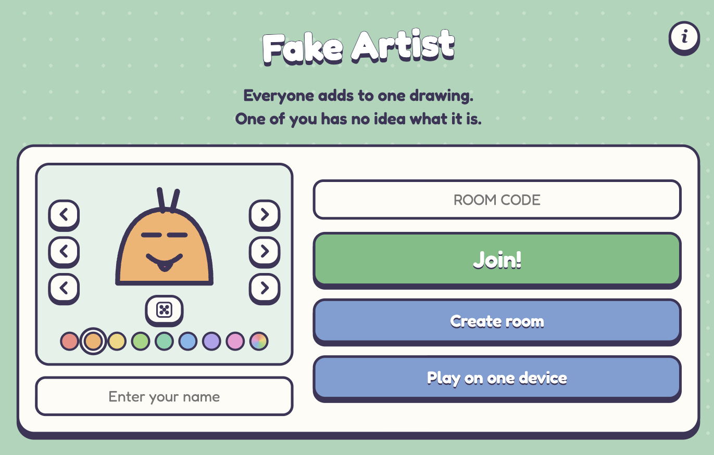
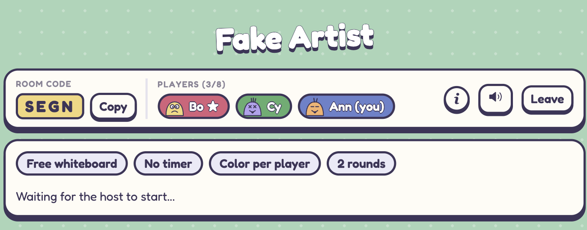
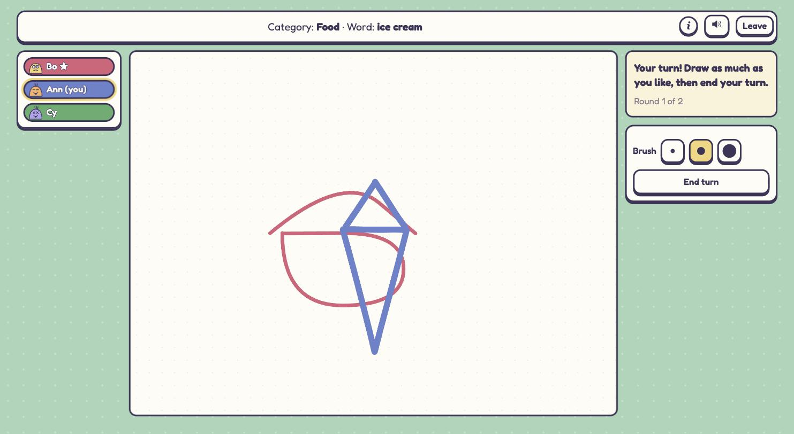
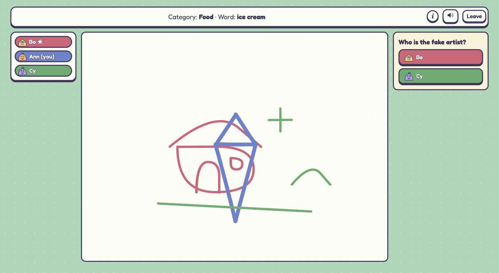
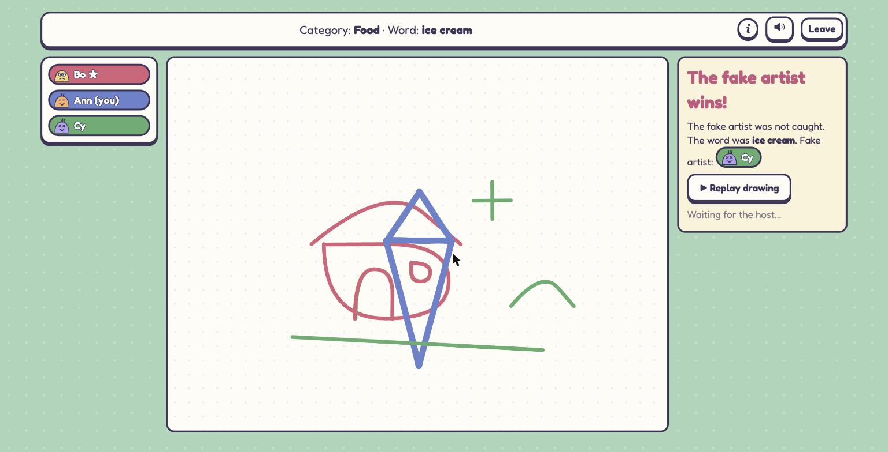

# Fake Artist

A multiplayer drawing and deduction game, in the spirit of *A Fake Artist Goes to New York*. Everyone adds to one shared drawing. All but one player know the secret word; the fake artist only knows the category and has to bluff. Play remotely with a room code, or pass one device around.

<p align="center"></p>

## Screenshots

| Lobby | Drawing |
| --- | --- |
|  |  |
| **Voting** | **Result** |
|  |  |

## Stack

- **Client:** React 19 + TypeScript, built with Vite (`src/`)
- **Server:** Node 22 + TypeScript, `ws` WebSockets, authoritative in-memory game rooms (`server/`)
- **Shared:** the wire protocol and constants live in `shared/protocol.ts` and are imported by both sides
- **Tests:** Vitest integration tests that drive a real server over WebSockets (`server/rooms.test.ts`)

## Develop

```sh
npm install
npm run dev        # server on :3000, Vite on :5173 (proxies /ws)
npm test
npm run typecheck
```

Open http://localhost:5173.

## Production build

```sh
npm run build      # client -> dist/client, server -> dist/server
PORT=3000 npm start
```

The server serves the built client and the `/ws` socket from one port.
